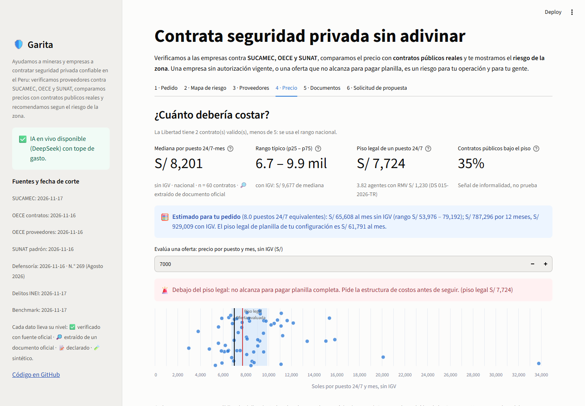

# 🛡️ Garita

> **Hacemos que contratar seguridad privada deje de ser un acto de fe para mineras y empresas en el Perú, verificando a cada proveedor contra SUCAMEC, OECE y SUNAT, comparando su precio con contratos públicos reales leídos con IA y mostrando el riesgo de la zona.**

**Demo:** https://garita-seguridad.streamlit.app/ · **Corre en local:** ver [Cómo correrlo](#cómo-correrlo) · **Video de respaldo:** en el issue del curso

Proyecto final de Data Science con Python, Universidad del Pacífico (2026-II).

---

## 1. One-liner

Hacemos la **verificación y comparación de proveedores de seguridad privada** para **mineras, puertos y plantas en el Perú** mediante **scraping de registros oficiales (SUCAMEC, OECE, SUNAT, Defensoría) y un LLM con salida estructurada que convierte cientos de contratos públicos en un precio por puesto-mes comparable**.

## 2. Founder

**José Miguel Díaz**, <<FOUNDER>>

## 3. Problema

**Quién lo sufre.** El jefe de seguridad patrimonial o de compras de una minera mediana, una planta o un puerto que tiene que contratar vigilancia, muchas veces en una zona de alto riesgo. Del otro lado, las empresas de seguridad formales, que pierden contratos frente a ofertas que no cubren el costo laboral.

**Cómo lo resuelve hoy.**
1. Pide cotizaciones a las empresas que conoce o que le recomendaron: la contratación de servicios corporativos en el Perú depende del boca a boca y de contactos personales ([Infomercado](https://infomercado.pe/bilda-consolida-su-plataforma-b2b-de-servicios-especializados-y-busca-impulsar-la-contratacion-industrial-en-el-peru/)).
2. Verifica a mano, empresa por empresa, la autorización en el [registro de SUCAMEC](https://www.sucamec.gob.pe/rgGSSP/aplicacion/resoluciones/List.xhtml). El link que piden las bases de licitación (`/web/index.php/empresas-de-seguridad`) hoy devuelve 404. Aparte revisa SUNAT y, si se acuerda, el buscador de proveedores del OECE.
3. Compara precios sin referencia: no sabe si una oferta barata es eficiente o si es barata porque no paga planilla.
4. Si es una minera grande, exige además una homologación anual hecha por un tercero (ver [competencia](docs/competencia.md)).

**Cuánto le cuesta.**
- **Riesgo legal.** Si la empresa de seguridad no paga a sus trabajadores y su fianza no alcanza, la empresa usuaria responde solidariamente por los adeudos laborales ([Ley 27626, arts. 24 y 25](https://lpderecho.pe/ley-intermediacion-laboral-ley-27626/)).
- **Riesgo de seguridad.** Una empresa sin autorización vigente para armas, o con personal informal, falla justo donde más se necesita. Pataz está en estado de emergencia por minería ilegal, con las Fuerzas Armadas a cargo del orden interno ([DS 137-2026-PCM](data/manual/estados_emergencia.csv)).
- **Tiempo.** Verificar cada proveedor contra tres fuentes y comparar cotizaciones toma días; medir cuántos es uno de los objetivos de las conversaciones con usuarios.
- **Informalidad del sector.** En los contratos públicos que leímos, **<<PCT_BAJO_PISO>>%** se pagan por debajo del piso legal de un puesto 24/7.

**Evidencia de usuarios.** En [`docs/research/`](docs/research/README.md) hay **3 entrevistas sintéticas**: un jefe de seguridad de una minera, el gerente de una empresa de seguridad y un analista de homologación. **Son personajes ficticios construidos con IA, no personas reales**, y cada dolor que expresan está respaldado por una fuente pública con link. Los tres coinciden por motivos distintos: hoy se contrata por boca a boca, y falta una herramienta formal que reúna legalidad, precio y riesgo. El comprador paga, la empresa formal gana argumentos y la homologadora es un canal. Las hipótesis H1 a H3 tienen respaldo público; la disposición a pagar (H4) no tiene evidencia y es lo primero que validaremos con usuarios reales, con el plan que está en la misma carpeta.

## 4. Solución e insight

**La solución.** El cliente describe su necesidad (lugar, puestos, horario, perfil, armamento y equipamiento) y Garita le devuelve:

1. **El riesgo de la zona**: conflictos sociales del departamento (Defensoría), casos ubicados en la provincia y estados de emergencia vigentes, en un mapa.
2. **Una lista corta de empresas con autorización vigente de SUCAMEC** para esa modalidad y departamento (y con armas si lo pide), cada una con un **puntaje de confianza de 0 a 100 que muestra de qué se compone**: autorización y vigencia (SUCAMEC), RUC activo y habido (SUNAT), habilitación para contratar con el Estado, penalidades, sanciones y contratos de vigilancia ganados (OECE), y cobertura.
3. **El precio justo**: rango de soles por puesto 24/7-mes en su departamento, el estimado de su pedido y una alerta cuando una oferta queda por debajo del **piso legal** del puesto.
4. **La lectura de cartas fianza y pólizas** con OCR y LLM, y un calendario de vencimientos (.ics).
5. **Una solicitud de propuesta** en Word y Excel lista para enviar a la lista corta.

**Cada dato dice de dónde viene**: ✅ verificado con fuente oficial (con link) · 🔎 extraído de un documento oficial con IA · 📝 declarado por la empresa · 🧪 sintético para el demo. Nunca se presenta un dato declarado o sintético como verificado.

**El insight.** El precio de un puesto de vigilancia sí es público, pero está escondido. El Estado contrata cientos de servicios de vigilancia al año y publica cada contrato con su monto y sus Bases. Nadie los había leído: las Bases dicen "12 agentes, 2 turnos, 365 días" en texto libre, casi siempre con OCR sucio o escaneadas. Garita las lee y las convierte en puestos, horas y meses, y con eso calcula por primera vez un **precio por puesto-mes comparable**: mediana nacional de **S/ <<MEDIANA_PUESTO_MES>>** sobre **<<N_CONTRATOS>> contratos** de <<N_DEPARTAMENTOS>> departamentos.

**El segundo insight.** La confianza no está en un solo registro. Una empresa puede estar autorizada por SUCAMEC y estar inhabilitada para contratar con el Estado o tener el RUC no habido. Cruzar las fuentes por RUC es trivial con código y lento a mano. Hoy solo **<<N_EMPRESAS_VIGILANCIA>> empresas** tienen autorización vigente de vigilancia privada en el registro de SUCAMEC.

## 5. Why now

- **Los datos ya son abiertos y legibles por máquina.** El OECE publica los contratos en el estándar OCDS con descargas mensuales y una API de proveedores; SUCAMEC mantiene en línea su registro con fecha de vencimiento ([SUCAMEC](https://www.gob.pe/institucion/sucamec/pages/9498-empresas-de-seguridad)).
- **Leer documentos dejó de ser caro.** Hace tres años, extraer puestos y turnos de cientos de Bases escaneadas exigía entrenar un modelo o pagarle a una persona. Hoy un LLM con salida JSON lo hace por centavos: **todo el benchmark costó US$ <<COSTO_PIPELINE>>** en llamadas a la API.
- **La seguridad en zonas mineras es más crítica que nunca.** El reporte N.° 269 de la Defensoría (agosto de 2026) registra **188 conflictos sociales**; 92 son socioambientales y **61 de ellos están ligados a la minería** ([Defensoría](https://www.defensoria.gob.pe/wp-content/uploads/2026/09/Reporte-de-conflictos-sociales-n-270.pdf)). Hay **31 estados de emergencia vigentes** por decreto supremo, incluidos Pataz, la minería ilegal de Cajamarca y Madre de Dios ([tabla curada con sus decretos](data/manual/estados_emergencia.csv)).
- **El costo laboral acaba de subir.** La remuneración mínima pasó de S/ 1,130 a **S/ 1,230 el 1 de octubre de 2026**, con un segundo tramo pendiente hasta S/ 1,300 ([DS 015-2026-TR](https://busquedas.elperuano.pe/dispositivo/EX/2559163-1)). Cada alza mueve el piso legal de un puesto 24/7 (hoy **S/ <<PISO_24H>>** al mes) y vuelve obsoletas las cotizaciones viejas.
- **El sector es grande y está fragmentado.** SUCAMEC reportaba 4,319 empresas y más de 125,000 agentes autorizados ([El Peruano](https://elperuano.pe/noticia/141085-sucamec-acredito-a-mas-de-125-mil-agentes-de-seguridad-en-todo-el-pais); **dato antiguo**, de alrededor de 2022). En el registro actual, Garita cuenta **<<N_EMPRESAS_SUCAMEC>> empresas** con alguna autorización vigente en las modalidades que importan a un comprador.

## 6. Demo

**URL pública:** https://garita-seguridad.streamlit.app/

**El flujo del demo (2 minutos):** "vigilancia con armas, 8 puestos 24/7, campamento minero en Pataz, La Libertad" → riesgo de la zona → lista corta con puntaje → precio y alerta de una oferta bajo el piso → lectura de una carta fianza escaneada → solicitud de propuesta en Word. Guion completo en [`docs/guion_demo.md`](docs/guion_demo.md).

| Pedido y riesgo de la zona | Proveedores con puntaje | Precio y piso legal |
|---|---|---|
|  |  |  |

### Arquitectura

```mermaid
flowchart LR
    subgraph Fuentes oficiales
        S[SUCAMEC<br/>formulario JSF]
        O[OECE<br/>API OCDS + ficha de proveedores]
        N[SUNAT<br/>padrón reducido]
        D[Defensoría<br/>reporte PDF]
        G[Límites distritales<br/>sesión 06]
    end
    subgraph Pipeline offline · run_pipeline.py
        S -->|03 scraping| P1[empresas autorizadas]
        O -->|03 API| P2[contratos de vigilancia<br/>+ links a Bases]
        P2 -->|10 Document AI<br/>triaje + OCR| P3[texto de TDR]
        P3 -->|08 DeepSeek JSON<br/>+ Pydantic| P4[puestos, horas, armado]
        P4 -->|Python| P5[benchmark S/ puesto-mes]
        O -->|03 API| P6[penalidades, inhabilitación]
        N -->|03| P7[RUC activo y habido]
        D -->|03 + 10| P8[conflictos por región y provincia]
        G -->|06 GeoPandas| P9[provincias]
    end
    P1 & P5 & P6 & P7 & P8 & P9 --> DP[(data/processed<br/>versionado = modo demo)]
    DP --> APP[App Streamlit · 05]
    DP --> MCP[MCP garita · 04]
    MCP --> SK[Skill evaluar-proveedor · 16]
    APP -->|en vivo, opcional| LLM[DeepSeek: pedido en texto libre<br/>y lectura de documentos]
```

### Modelos y APIs, y por qué

| Qué | Para qué | Por qué este |
|---|---|---|
| **DeepSeek `deepseek-chat`** con el SDK de OpenAI y `response_format` JSON | Leer las Bases (puestos, horas, armado, perfil), entender el pedido y leer documentos | El más barato con JSON fiable en español: el benchmark completo costó US$ <<COSTO_PIPELINE>>. Mismo patrón que el HW3. |
| **Pydantic** | Validar cada respuesta del LLM; un reintento con el error | Un número que no valida no entra al benchmark: un hueco es mejor que un dato inventado |
| **PaddleOCR / RapidOCR (modelos PP-OCR en ONNX)** | Páginas escaneadas de las Bases y documentos subidos | PaddleOCR es el de la sesión 10; en Streamlit Cloud no cabe, así que corren los mismos modelos PP-OCR en ONNX |
| **PyMuPDF** | Capa de texto y rasterizado de páginas | Rápido y sin dependencias de sistema |
| **API OCDS y buscador de proveedores del OECE** | Contratos, montos, plazos, Bases, inhabilitaciones y penalidades | Fuente oficial, abierta y por RUC |
| **GeoPandas + Folium** | Provincias disueltas desde distritos y mapa de riesgo | Herramientas de la sesión 06 |
| **Streamlit Community Cloud** | Despliegue gratuito | URL pública con secretos para la clave |

## 7. Modelo de negocio

**Quién paga.** La empresa que contrata seguridad: mineras medianas, plantas y puertos. No el proveedor de seguridad, para que la recomendación sea neutral.

| Producto | Precio | Qué incluye |
|---|---|---|
| **Garita Empresa** | **S/ 1,500 al mes** por empresa compradora | Verificación, benchmark de precios, riesgo por zona, lectura de documentos, alertas de vencimiento y solicitudes de propuesta ilimitadas |
| Comisión (etapa 2) | 3 % a 5 % del contrato cuando Garita intermedia la contratación | Convocatoria y gestión del contrato |
| Perfil premium (etapa 2) | Suscripción para empresas de seguridad | Perfil y documentos al día; **no altera el puntaje** |

Ejemplo de la comisión: 8 puestos 24/7 a la mediana de S/ <<MEDIANA_PUESTO_MES>> por 12 meses son S/ <<CONTRATO_EJEMPLO>>; el 3 % es S/ <<COMISION_EJEMPLO>>.

**Costo por usuario** (precios de DeepSeek verificados el 20/09/2026, con su tarifa por franja horaria en [`garita/costos.py`](garita/costos.py)):

| Concepto | Costo | Fuente |
|---|---|---|
| Normalización de los contratos (pipeline) | **US$ <<COSTO_PIPELINE>>** por corrida (<<N_LLAMADAS>> llamadas, ~<<TOKENS_POR_PROCESO>> tokens por proceso), una vez al mes y compartido entre todos los clientes | [`logs/costos.csv`](logs/costos.csv) |
| Una consulta en la app (pedido o documento) | ~<<TOKENS_POR_CONSULTA>> tokens, **US$ <<COSTO_POR_CONSULTA>>** | `logs/costos.csv`; referencia del HW3 del autor: 32 llamadas por US$ 0.013, entre US$ 0.0003 y 0.0012 cada una |
| Uso típico de un cliente al mes (**estimado**) | 4 contrataciones × ~6 llamadas = 24 llamadas ≈ **US$ <<COSTO_CLIENTE_MES>>** | Supuesto a validar con usuarios |
| Servidor del demo | US$ 0 (Streamlit Community Cloud) | |
| Servidor en producción (**estimado**) | US$ 20 a 40 al mes compartidos | Una máquina virtual pequeña |

El costo variable en tokens es menos del 0.1 % del precio. El costo real es vender y mantener los datos al día, no el cómputo. Tope de gasto: `GARITA_TOPE_USD` (por defecto US$ 3); al alcanzarlo, la app sigue en modo demo.

## 8. Herramientas del curso y dónde están

**Las dos que justifican la rúbrica:**

1. **Scraping y APIs (sesión 03).** Sin ella no hay producto: replica el formulario JSF de SUCAMEC (ViewState, botón Buscar y paginador de PrimeFaces, por departamento porque el buscador corta en 2,000), consume la API OCDS y la ficha de proveedores del OECE, el padrón de SUNAT y el índice de reportes de la Defensoría. Automatiza la verificación que hoy se hace a mano. → [`garita/sucamec.py`](garita/sucamec.py), [`garita/oece.py`](garita/oece.py), [`garita/sunat.py`](garita/sunat.py), [`garita/defensoria.py`](garita/defensoria.py), [`garita/red.py`](garita/red.py)
2. **LLMs con salidas estructuradas (sesión 08).** Es el insight: convierte Bases en texto libre y OCR sucio en puestos, horas, armado, plazo y perfil, en JSON validado con Pydantic, para que Python calcule un precio por puesto-mes que hoy no existe. → [`garita/esquemas.py`](garita/esquemas.py), [`garita/llm.py`](garita/llm.py), [`garita/extraccion.py`](garita/extraccion.py), [`garita/costos.py`](garita/costos.py), [`garita/benchmark.py`](garita/benchmark.py)

**También dentro del producto:**

| Herramienta | Para qué | Dónde |
|---|---|---|
| Document AI (10) | Triaje texto/imagen, OCR solo en páginas escaneadas, TDR de las Bases, cuadros de la Defensoría, documentos subidos | [`garita/documentos.py`](garita/documentos.py), [`garita/defensoria.py`](garita/defensoria.py) |
| GeoPandas y Folium (06) | Provincias desde distritos, centroides, distancia sede–sitio, mapa de riesgo | [`garita/geo.py`](garita/geo.py) |
| Dashboards (05) | La app de 6 pestañas | [`app.py`](app.py) |
| MCP (04) | "Garita para Claude": 8 herramientas de consulta, plugin instalable | [`mcp_server/server.py`](mcp_server/server.py), [`.claude-plugin/`](.claude-plugin/) |
| Skills de Claude Code (16) | Skill del producto `evaluar-proveedor-seguridad` y 4 de desarrollo | [`skills/`](skills/), [`.claude/skills/`](.claude/skills/) |
| Despliegue y evaluación (12) | Streamlit Cloud con modo demo; LLM contra línea base de reglas | [`eval/evaluar_extraccion.py`](eval/evaluar_extraccion.py) |

El detalle por subcategoría (qué parte descarga, cuál lee los labels, cuál limpia, cuál guarda) está en [`docs/mapa_herramientas.md`](docs/mapa_herramientas.md); cada sección está marcada en el código con `# ===== HERRAMIENTA NN` y `# --- NN.k`.

**Evaluación (sesión 12).** Sobre los <<N_EVAL>> procesos con TDR legible:

<<TABLA_EVAL>>

### Garita para Claude (MCP + skill)

Un analista de compras puede usar los mismos datos desde Claude: el MCP pone los datos y la skill pone el método.

```text
/plugin marketplace add josemigueldiaz1/Garita-StartupProject
/plugin install garita@garita
```

Luego: *"Evalúa estas tres propuestas de seguridad para un campamento en Pataz"*. En este repo, `.mcp.json` ya registra el servidor para Claude Code.

## 9. Qué hizo el agente

Este proyecto se construyó con **Claude Code (Claude Opus 5.5)** en una sesión de trabajo guiada por el founder.

| Parte | Quién |
|---|---|
| Idea, problema, decisión de enfocar en confianza y precio, requisitos del servicio, reglas de datos | José |
| Búsqueda y prueba de las fuentes: hallazgo del registro JSF de SUCAMEC (el link de las bases da 404), del tope de 2,000 resultados, de la ficha JSON del OECE, del padrón de SUNAT y de los cuadros de la Defensoría | Claude Code |
| Todo el código de `garita/`, `app.py`, `run_pipeline.py` y `eval/` | Claude Code |
| Servidor MCP, plugin, skills y pruebas (`mcp_server/`, `skills/`, `.claude/skills/`, `tests/`) | Un subagente de Claude Code en paralelo |
| Investigación de competencia, guía de conversaciones, plantilla, guion, borrador del README y tabla de estados de emergencia con sus decretos | Otro subagente de Claude Code en paralelo |
| Conversaciones con usuarios, revisión, clave de la API, despliegue y presentación | José |

**Código reutilizado de las tareas del autor** ([repo de tareas](https://github.com/josemigueldiaz1/repo-JoseMiguelDiaz)):
- `HW3_Diaz/tarea2_radar/src/adquisicion.py` → base de [`garita/oece.py`](garita/oece.py) (API OCDS, descarga mensual con caché, una fila por ocid).
- `HW3_Diaz/tarea1_rag_normativo/src/costos.py` → [`garita/costos.py`](garita/costos.py) (registro por llamada y tarifa por franja de DeepSeek; se agregó el tope de gasto).
- `HW3_Diaz/tarea1_rag_normativo/src/motor.py` → el patrón de [`garita/llm.py`](garita/llm.py) (cliente de OpenAI con `base_url` de DeepSeek y `response_format` JSON; se agregó Pydantic).
- Curso: el servidor MCP sigue el patrón de `sessions/04-mcp-claude-code`, el triaje de Document AI la regla de `sessions/10-document-ai-voz/lab/src/triaje.py` y los límites distritales vienen de `sessions/06-geoespacial`.

---

## Cómo correrlo

Necesitas Python 3.12 (uv lo instala si no lo tienes) y git.

**Windows (PowerShell)**
```powershell
pip install uv            # o: powershell -ExecutionPolicy ByPass -c "irm https://astral.sh/uv/install.ps1 | iex"
git clone https://github.com/josemigueldiaz1/Garita-StartupProject.git
cd Garita-StartupProject
uv sync
uv run streamlit run app.py
```

**macOS y Linux**
```bash
curl -LsSf https://astral.sh/uv/install.sh | sh
git clone https://github.com/josemigueldiaz1/Garita-StartupProject.git
cd Garita-StartupProject
uv sync
uv run streamlit run app.py
```

La app abre en `http://localhost:8501` y funciona **sin clave** (modo demo con los datos de `data/processed`). Para las funciones con IA en vivo, crea `.env` en la raíz del repo con `DEEPSEEK_API_KEY=` y tu clave (en Windows: `notepad .env`; hay un ejemplo en `.env.example`).

Sin uv: `python -m venv .venv`, actívalo (`.venv\Scripts\activate` en Windows, `source .venv/bin/activate` en macOS/Linux), `pip install -r requirements.txt` y `streamlit run app.py`.

**Regenerar los datos**
```bash
uv run python run_pipeline.py                                  # fuentes, sin LLM
uv run python run_pipeline.py --pasos documentos,extraer,benchmark   # gasta tokens, con tope
uv sync --group ocr                                            # PaddleOCR en local (opcional)
uv run python eval/evaluar_extraccion.py                       # LLM contra línea base
uv run pytest                                                  # pruebas
```

**Despliegue en Streamlit Community Cloud:** `app.py`, Python 3.12, y en *Settings → Secrets* `DEEPSEEK_API_KEY = "..."` y `GARITA_TOPE_USD = "1.00"`. `requirements.txt` y `packages.txt` ya están en el repo.

## Datos y privacidad

Solo datos de **empresas**: nunca nombres, DNI, fotos ni medidas de vigilantes. La estatura o la edad son requisitos que pide el cliente, no una base de personas. Del padrón de SUNAT solo se guardan RUC de personas jurídicas (20). Los documentos de ejemplo son **sintéticos** y lo dicen en su encabezado. El diccionario de datos y los niveles están en [`docs/datos.md`](docs/datos.md).

## Licencia

MIT. Ver [LICENSE](LICENSE).
