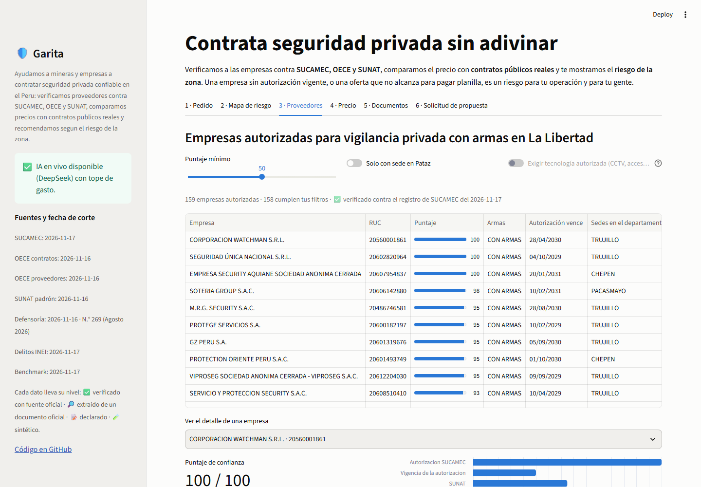

# 🛡️ Garita

> **Hacemos que contratar seguridad privada deje de ser un acto de fe para mineras y empresas en el Perú, verificando a cada proveedor contra SUCAMEC, OECE y SUNAT, comparando su precio con contratos públicos reales leídos con IA y mostrando el riesgo de la zona.**

**Demo:** https://garita-seguridad.streamlit.app/ · **Corre en local:** ver [Cómo correrlo](#cómo-correrlo) · **Video de respaldo:** en el issue del curso

Proyecto final de Data Science con Python, Universidad del Pacífico (2026-II).

---

## 1. One-liner

Hacemos la **verificación y comparación de proveedores de seguridad privada** para **mineras, puertos y plantas en el Perú** mediante **scraping de registros oficiales (SUCAMEC, OECE, SUNAT, Defensoría) y un LLM con salida estructurada que convierte cientos de contratos públicos en un precio por puesto-mes comparable**.

## 2. Founder

**José Miguel Díaz**, estudiante de 8.º ciclo de la Universidad del Pacífico. Me apasionan la macroeconomía y las finanzas, pero más que eso me mueve resolver problemas reales de personas reales: de esos que, al solucionarlos, dejan al país un poco mejor. Creo que la programación y la IA ponen ese poder al alcance de cualquiera que se lo proponga. Por eso nació la idea de Garita.

## 3. Problema

**Quién lo sufre.** El jefe de seguridad patrimonial o de compras de una minera mediana, una planta o un puerto que tiene que contratar vigilancia, muchas veces en una zona de alto riesgo. Del otro lado, las empresas de seguridad formales, que pierden contratos frente a ofertas que no cubren el costo laboral.

**Cómo lo resuelve hoy.**
1. Pide cotizaciones a las empresas que conoce o que le recomendaron: la contratación de servicios corporativos en el Perú depende del boca a boca y de contactos personales ([Infomercado](https://infomercado.pe/bilda-consolida-su-plataforma-b2b-de-servicios-especializados-y-busca-impulsar-la-contratacion-industrial-en-el-peru/)).
2. Verifica a mano, empresa por empresa, la autorización en el [registro de SUCAMEC](https://www.sucamec.gob.pe/rgGSSP/aplicacion/resoluciones/List.xhtml). El link que piden las bases de licitación (`/web/index.php/empresas-de-seguridad`) hoy devuelve 404. Aparte revisa SUNAT y, si se acuerda, el buscador de proveedores del OECE.
3. Compara precios sin referencia: no sabe si una oferta barata es eficiente o si es barata porque no paga planilla.
4. Si es una minera grande, exige además una homologación anual hecha por un tercero (ver [competencia](docs/competencia.md)).

**Cuánto le cuesta.**
- **Riesgo legal.** Si la empresa de seguridad no paga a sus trabajadores y su fianza no alcanza, la empresa usuaria responde solidariamente por los adeudos laborales ([Ley 27626, arts. 24 y 25](https://lpderecho.pe/ley-intermediacion-laboral-ley-27626/)).
- **Riesgo de seguridad.** Una empresa sin autorización vigente para armas, o con personal informal, falla justo donde más se necesita. Pataz está en estado de emergencia por minería ilegal, con las Fuerzas Armadas a cargo del orden interno ([DS 137-2026-PCM](data/manual/estados_emergencia.csv)).
- **Tiempo.** Verificar cada proveedor contra tres fuentes y comparar cotizaciones toma días; medir cuántos es uno de los objetivos de las conversaciones con usuarios.
- **Informalidad del sector.** En los contratos públicos de vigilancia que leímos, el **35%** se paga por debajo del costo mínimo de planilla de un puesto 24/7 vigente cuando se firmó (comparando ambos sin IGV). La razón aparece en las propias Bases: la mediana es de **2 agentes por puesto 24/7**, es decir, turnos de 12 horas los 7 días (84 horas semanales frente a un máximo legal de 48).

**Evidencia de usuarios.** En [`docs/research/`](docs/research/README.md) hay **3 entrevistas sintéticas**: un jefe de seguridad de una minera, el gerente de una empresa de seguridad y un analista de homologación. **Son personajes ficticios construidos con IA, no personas reales**, y cada dolor que expresan está respaldado por una fuente pública con link. Los tres coinciden por motivos distintos: hoy se contrata por boca a boca, y falta una herramienta formal que reúna legalidad, precio y riesgo. El comprador paga, la empresa formal gana argumentos y la homologadora es un canal. Las hipótesis H1 a H3 tienen respaldo público; la disposición a pagar (H4) no tiene evidencia y es lo primero que validaremos con usuarios reales, con el plan que está en la misma carpeta.

## 4. Solución e insight

**La solución.** El cliente describe su necesidad (lugar, puestos, horario, perfil, armamento y equipamiento) y Garita le devuelve:

1. **Un mapa de riesgo para cualquier región del Perú**: delitos denunciados por cada 10 mil habitantes (INEI, con datos del SIDPOL de la PNP), conflictos sociales (Defensoría), estados de emergencia vigentes con su motivo (minería ilegal, crimen organizado, narcotráfico) y cuántas empresas autorizadas tienen sede en cada provincia.
2. **Una lista corta de empresas con autorización vigente de SUCAMEC** para esa modalidad y departamento (y con armas si lo pide), cada una con un **puntaje de confianza de 0 a 100 que muestra de qué se compone**: autorización y vigencia (SUCAMEC), RUC activo y habido (SUNAT), habilitación para contratar con el Estado, penalidades, sanciones y contratos de vigilancia ganados (OECE), y cobertura.
3. **El precio justo**: rango de soles por puesto 24/7-mes en su departamento, el estimado de su pedido y una alerta cuando una oferta queda por debajo del **piso legal** del puesto.
4. **La lectura de cartas fianza y pólizas** con OCR y LLM, y un calendario de vencimientos (.ics).
5. **Una solicitud de propuesta** en Word y Excel lista para enviar a la lista corta.

**Cada dato dice de dónde viene**: ✅ verificado con fuente oficial (con link) · 🔎 extraído de un documento oficial con IA · 📝 declarado por la empresa · 🧪 sintético para el demo. Nunca se presenta un dato declarado o sintético como verificado.

**El insight.** El precio de un puesto de vigilancia sí es público, pero está escondido. El Estado contrata cientos de servicios de vigilancia al año y publica cada contrato con su monto y sus Bases. Nadie los había leído: las Bases dicen "12 agentes, 2 turnos, 365 días" en texto libre, casi siempre con OCR sucio o escaneadas. Garita las lee y las convierte en puestos, horas y meses, y con eso calcula por primera vez un **precio por puesto-mes comparable**: mediana nacional de **S/ 8,201 por puesto 24/7 al mes sin IGV** (rango típico S/ 6,747 a S/ 9,899) sobre **60 contratos de 18 departamentos**, leídos de 200 Bases con un costo total de US$ 0.56.

**El segundo insight.** La confianza no está en un solo registro. Una empresa puede estar autorizada por SUCAMEC y estar inhabilitada para contratar con el Estado o tener el RUC no habido. Cruzar las fuentes por RUC es trivial con código y lento a mano. Hoy solo **1,004 empresas** tienen autorización vigente de vigilancia privada en el registro de SUCAMEC.

## 5. Why now

- **Los datos ya son abiertos y legibles por máquina.** El OECE publica los contratos en el estándar OCDS con descargas mensuales y una API de proveedores; SUCAMEC mantiene en línea su registro con fecha de vencimiento ([SUCAMEC](https://www.gob.pe/institucion/sucamec/pages/9498-empresas-de-seguridad)).
- **Leer documentos dejó de ser caro.** Hace tres años, extraer puestos y turnos de cientos de Bases escaneadas exigía entrenar un modelo o pagarle a una persona. Hoy un LLM con salida JSON lo hace por centavos: **todo el benchmark costó US$ 0.56** en llamadas a la API.
- **La seguridad en zonas mineras es más crítica que nunca.** El reporte N.° 269 de la Defensoría (agosto de 2026) registra **188 conflictos sociales**; 92 son socioambientales y **61 de ellos están ligados a la minería** ([Defensoría](https://www.defensoria.gob.pe/wp-content/uploads/2026/09/Reporte-de-conflictos-sociales-n-270.pdf)). Hay **31 estados de emergencia vigentes** por decreto supremo, incluidos Pataz, la minería ilegal de Cajamarca y Madre de Dios ([tabla curada con sus decretos](data/manual/estados_emergencia.csv)).
- **El costo laboral acaba de subir.** La remuneración mínima pasó de S/ 1,130 a **S/ 1,230 el 1 de octubre de 2026**, con un segundo tramo pendiente hasta S/ 1,300 ([DS 015-2026-TR](https://busquedas.elperuano.pe/dispositivo/EX/2559163-1)). Cada alza mueve el piso legal de un puesto 24/7 (hoy **S/ 7,724** al mes solo en planilla) y vuelve obsoletas las cotizaciones viejas.
- **El sector es grande y está fragmentado.** SUCAMEC reportaba 4,319 empresas y más de 125,000 agentes autorizados ([El Peruano](https://elperuano.pe/noticia/141085-sucamec-acredito-a-mas-de-125-mil-agentes-de-seguridad-en-todo-el-pais); **dato antiguo**, de alrededor de 2022). En el registro actual, Garita cuenta **1,041 empresas** con alguna autorización vigente en las modalidades que importan a un comprador.

## 6. Demo

**URL pública:** https://garita-seguridad.streamlit.app/

**El flujo del demo (2 minutos):** "vigilancia con armas, 8 puestos 24/7, campamento minero en Pataz, La Libertad" → riesgo de la zona → lista corta con puntaje → precio y alerta de una oferta bajo el piso → lectura de una carta fianza escaneada → solicitud de propuesta en Word. Guion completo en [`docs/guion_demo.md`](docs/guion_demo.md).

| Mapa de riesgo por región | Proveedores con puntaje | Precio y piso legal |
|---|---|---|
|  |  |  |

### Arquitectura

```mermaid
flowchart LR
    subgraph Fuentes oficiales
        S[SUCAMEC<br/>formulario JSF]
        O[OECE<br/>API OCDS + ficha de proveedores]
        N[SUNAT<br/>padrón reducido]
        D[Defensoría<br/>reporte PDF]
        I[INEI<br/>delitos por región]
        G[Límites distritales<br/>sesión 06]
    end
    subgraph Pipeline offline · run_pipeline.py
        S -->|03 scraping| P1[empresas autorizadas]
        O -->|03 API| P2[contratos de vigilancia<br/>+ links a Bases]
        P2 -->|10 Document AI<br/>triaje + OCR| P3[texto de TDR]
        P3 -->|08 DeepSeek JSON<br/>+ Pydantic| P4[puestos, horas, armado]
        P4 -->|Python| P5[benchmark S/ puesto-mes]
        O -->|03 API| P6[penalidades, inhabilitación]
        N -->|03| P7[RUC activo y habido]
        D -->|03 + 10| P8[conflictos por región y provincia]
        G -->|06 GeoPandas| P9[provincias]
        I -->|03 Excel| P10[delitos por 10 mil hab.]
    end
    P1 & P5 & P6 & P7 & P8 & P9 & P10 --> DP[(data/processed<br/>versionado = modo demo)]
    DP --> APP[App Streamlit · 05]
    DP --> MCP[MCP garita · 04]
    MCP --> SK[Skill evaluar-proveedor · 16]
    APP -->|en vivo, opcional| LLM[DeepSeek: pedido en texto libre<br/>y lectura de documentos]
```

### Modelos y APIs, y por qué

| Qué | Para qué | Por qué este |
|---|---|---|
| **DeepSeek `deepseek-chat`** (la API lo atiende hoy con `deepseek-flash`, según el campo `model` de su respuesta del 18/11/2026) con el SDK de OpenAI y `response_format` JSON | Leer las Bases (puestos, horas, armado, perfil), entender el pedido y leer documentos | El más barato con JSON fiable en español: el benchmark completo costó US$ 0.56. Mismo patrón que el HW3. |
| **Pydantic** | Validar cada respuesta del LLM; un reintento con el error | Un número que no valida no entra al benchmark: un hueco es mejor que un dato inventado |
| **PaddleOCR / RapidOCR (modelos PP-OCR en ONNX)** | Páginas escaneadas de las Bases y documentos subidos | PaddleOCR es el de la sesión 10; en Streamlit Cloud no cabe, así que corren los mismos modelos PP-OCR en ONNX |
| **PyMuPDF** | Capa de texto y rasterizado de páginas | Rápido y sin dependencias de sistema |
| **API OCDS y buscador de proveedores del OECE** | Contratos, montos, plazos, Bases, inhabilitaciones y penalidades | Fuente oficial, abierta y por RUC |
| **GeoPandas + Folium** | Provincias disueltas desde distritos y mapa de riesgo | Herramientas de la sesión 06 |
| **Streamlit Community Cloud** | Despliegue gratuito | URL pública con secretos para la clave |

## 7. Modelo de negocio

**Quién paga.** La empresa que contrata seguridad: mineras medianas, plantas y puertos. No el proveedor de seguridad, para que la recomendación sea neutral.

| Producto | Precio | Qué incluye |
|---|---|---|
| **Garita Empresa** | **S/ 1,500 al mes** por empresa compradora | Verificación, benchmark de precios, riesgo por zona, lectura de documentos, alertas de vencimiento y solicitudes de propuesta ilimitadas |
| Comisión (etapa 2) | 3 % a 5 % del contrato cuando Garita intermedia la contratación | Convocatoria y gestión del contrato |
| Perfil premium (etapa 2) | Suscripción para empresas de seguridad | Perfil y documentos al día; **no altera el puntaje** |

Ejemplo de la comisión: 8 puestos 24/7 a la mediana de S/ 8,201 sin IGV por 12 meses son S/ 787,296; el 3 % es S/ 23,619.

**¿Por qué un puesto 24/7 cuesta más de S/ 7,700 al mes?** Porque no es un vigilante: son 168 horas a la semana y la jornada máxima es de 48, así que se necesitan 3.8 agentes. Cada uno cuesta unos S/ 2,023 al mes con la RMV de S/ 1,230, el recargo nocturno, EsSalud, SCTR, Vida Ley, gratificaciones, CTS y vacaciones. Eso suma S/ 7,724 solo de planilla, antes de uniformes, armas, supervisión, seguros, utilidad e IGV ([`garita/benchmark.py`](garita/benchmark.py)).

**Costo por usuario** (precios de DeepSeek verificados el 20/09/2026, con su tarifa por franja horaria en [`garita/costos.py`](garita/costos.py)):

| Concepto | Costo | Fuente |
|---|---|---|
| Normalización de los contratos (pipeline) | **US$ 0.56** por corrida completa (322 llamadas en dos pasadas, ~7,300 tokens por proceso), una vez al mes y compartido entre todos los clientes | [`logs/costos.csv`](logs/costos.csv) |
| Una consulta en la app (pedido o documento) | ~440 tokens el pedido (US$ 0.00013) y ~1,000 una carta fianza (US$ 0.0002) | `logs/costos.csv`; referencia del HW3 del autor: 32 llamadas por US$ 0.013, entre US$ 0.0003 y 0.0012 cada una |
| Uso típico de un cliente al mes (**estimado**) | 4 contrataciones × ~6 llamadas = 24 llamadas ≈ **US$ 0.005** | Supuesto a validar con usuarios |
| Servidor del demo | US$ 0 (Streamlit Community Cloud) | |
| Servidor en producción (**estimado**) | US$ 20 a 40 al mes compartidos | Una máquina virtual pequeña |

El costo variable en tokens es menos del 0.1 % del precio. El costo real es vender y mantener los datos al día, no el cómputo. Tope de gasto: `GARITA_TOPE_USD` (por defecto US$ 3); al alcanzarlo, la app sigue en modo demo.

## 8. Herramientas del curso y dónde están

**Las dos que justifican la rúbrica:**

1. **Scraping y APIs (sesión 03).** Sin ella no hay producto: replica el formulario JSF de SUCAMEC (ViewState, botón Buscar y paginador de PrimeFaces, por departamento porque el buscador corta en 2,000), consume la API OCDS y la ficha de proveedores del OECE, el padrón de SUNAT, el índice de reportes de la Defensoría y los Excel de delitos por departamento del INEI. Automatiza la verificación que hoy se hace a mano. → [`garita/sucamec.py`](garita/sucamec.py), [`garita/oece.py`](garita/oece.py), [`garita/sunat.py`](garita/sunat.py), [`garita/defensoria.py`](garita/defensoria.py), [`garita/delitos.py`](garita/delitos.py), [`garita/red.py`](garita/red.py)
2. **LLMs con salidas estructuradas (sesión 08).** Es el insight: convierte Bases en texto libre y OCR sucio en puestos, horas, armado, plazo y perfil, en JSON validado con Pydantic, para que Python calcule un precio por puesto-mes que hoy no existe. → [`garita/esquemas.py`](garita/esquemas.py), [`garita/llm.py`](garita/llm.py), [`garita/extraccion.py`](garita/extraccion.py), [`garita/costos.py`](garita/costos.py), [`garita/benchmark.py`](garita/benchmark.py)

**También dentro del producto:**

| Herramienta | Para qué | Dónde |
|---|---|---|
| Document AI (10) | Triaje texto/imagen, OCR solo en páginas escaneadas, TDR de las Bases, cuadros de la Defensoría, documentos subidos | [`garita/documentos.py`](garita/documentos.py), [`garita/defensoria.py`](garita/defensoria.py) |
| GeoPandas y Folium (06) | Provincias y regiones desde distritos, centroides, distancia sede–sitio, mapa nacional de riesgo con íconos por motivo de emergencia y empresas por provincia | [`garita/geo.py`](garita/geo.py) |
| Dashboards (05) | La app de 6 pestañas | [`app.py`](app.py) |
| MCP (04) | "Garita para Claude": 8 herramientas de consulta, plugin instalable | [`mcp_server/server.py`](mcp_server/server.py), [`.claude-plugin/`](.claude-plugin/) |
| Skills de Claude Code (16) | Skill del producto `evaluar-proveedor-seguridad` y 4 de desarrollo | [`skills/`](skills/), [`.claude/skills/`](.claude/skills/) |
| Despliegue y evaluación (12) | Streamlit Cloud con modo demo; LLM contra línea base de reglas | [`eval/evaluar_extraccion.py`](eval/evaluar_extraccion.py) |

El detalle por subcategoría (qué parte descarga, cuál lee los labels, cuál limpia, cuál guarda) está en [`docs/mapa_herramientas.md`](docs/mapa_herramientas.md); cada sección está marcada en el código con `# ===== HERRAMIENTA NN` y `# --- NN.k`.

**Evaluación (sesión 12).** No hay un conjunto etiquetado de puestos por contrato, así que se compara el LLM con una línea base de reglas ("N puestos", "N agentes", "24 horas") sobre el mismo texto de los 175 procesos con Bases leídas, con tres medidas que no necesitan etiquetas ([`eval/evaluar_extraccion.py`](eval/evaluar_extraccion.py)):

| Método | Procesos con puestos | Precios plausibles (S/ 1,500–50,000) | Mediana S/ por puesto-mes (con IGV) | Dispersión (IQR / mediana) |
|---|---:|---:|---:|---:|
| Línea base de reglas | 53 | 66.0 % | 12,824 | 1.20 |
| **LLM (deepseek-chat + Pydantic)** | **78** | **98.7 %** | **9,061** | **0.50** |

El LLM encuentra puestos en un 47% más de procesos, casi todos sus precios son plausibles y su dispersión es la mitad: lee mejor las tablas de puestos que una regla fija.

**Verificación manual (17/11/2026).** Se revisaron a mano, con su cita de evidencia, los contratos más baratos y los más caros. Aparecieron los dos errores típicos del LLM: contar **agentes como puestos** ("53 agentes" leído como 53 puestos 24/7, con un precio cuatro veces menor) y contar **una sede como un puesto** ("03 agentes día y 03 noche" leído como 1 puesto, con un precio triple). Se agregó una regla de consistencia con los agentes que declaran las mismas Bases: un puesto 24/7 necesita entre 2 y 5 agentes. Si no, el contrato sale del benchmark y queda en la tabla con su motivo. Esa regla excluyó 15 contratos; el benchmark final usa 60. Una muestra aleatoria de 15 extracciones, con su cita textual y el link a las Bases, está en [`eval/resultados/auditoria_muestra.csv`](eval/resultados/auditoria_muestra.csv) para revisión humana.

### Garita para Claude (MCP + skill)

Un analista de compras puede usar los mismos datos desde Claude: el MCP pone los datos y la skill pone el método.

```text
/plugin marketplace add josemigueldiaz1/Garita-StartupProject
/plugin install garita@garita
```

Luego: *"Evalúa estas tres propuestas de seguridad para un campamento en Pataz"*. En este repo, `.mcp.json` ya registra el servidor para Claude Code.

## 9. Qué hizo el agente

Este proyecto se construyó con **Claude Code (Claude Opus 5.5)** en una sesión de trabajo guiada por el founder.

| Parte | Quién |
|---|---|
| Idea, problema, decisión de enfocar en confianza y precio, requisitos del servicio, reglas de datos | José |
| Búsqueda y prueba de las fuentes: hallazgo del registro JSF de SUCAMEC (el link de las bases da 404), del tope de 2,000 resultados, de la ficha JSON del OECE, del padrón de SUNAT y de los cuadros de la Defensoría | Claude Code |
| Todo el código de `garita/`, `app.py`, `run_pipeline.py` y `eval/` | Claude Code |
| Servidor MCP, plugin, skills y pruebas (`mcp_server/`, `skills/`, `.claude/skills/`, `tests/`) | Un subagente de Claude Code en paralelo |
| Investigación de competencia, guía de conversaciones, plantilla, guion, borrador del README y tabla de estados de emergencia con sus decretos | Otro subagente de Claude Code en paralelo |
| Conversaciones con usuarios, revisión, clave de la API, despliegue y presentación | José |

**Código reutilizado de las tareas del autor** ([repo de tareas](https://github.com/josemigueldiaz1/repo-JoseMiguelDiaz)):
- `HW3_Diaz/tarea2_radar/src/adquisicion.py` → base de [`garita/oece.py`](garita/oece.py) (API OCDS, descarga mensual con caché, una fila por ocid).
- `HW3_Diaz/tarea1_rag_normativo/src/costos.py` → [`garita/costos.py`](garita/costos.py) (registro por llamada y tarifa por franja de DeepSeek; se agregó el tope de gasto).
- `HW3_Diaz/tarea1_rag_normativo/src/motor.py` → el patrón de [`garita/llm.py`](garita/llm.py) (cliente de OpenAI con `base_url` de DeepSeek y `response_format` JSON; se agregó Pydantic).
- Curso: el servidor MCP sigue el patrón de `sessions/04-mcp-claude-code`, el triaje de Document AI la regla de `sessions/10-document-ai-voz/lab/src/triaje.py` y los límites distritales vienen de `sessions/06-geoespacial`.

---

## Opcionales: mercado, competencia, primeros usuarios, roadmap y riesgos

### Mercado (TAM, SAM y SOM)

Todas las cifras son **estimadas** y sus supuestos están a la vista.

| Nivel | Cifra | Supuesto |
|---|---|---|
| TAM: gasto en seguridad privada en el Perú | Entre US$ 400 millones y US$ 1,400 millones al año (**dato antiguo**) | US$ 400 millones según EULEN Perú en 2021 ([Infomercado](https://infomercado.pe/peru-sector-seguridad-mueve-mas-de-400-millones-de-dolares-en-el-pais/)); US$ 1,400 millones según Prosegur en 2018 ([Prosegur](https://www.euroamerica.org/wp-content/uploads/2018/06/LopezMartin_Prosegur_PPT_Peru-UE2018.pdf)) |
| SAM: suscripciones de empresas compradoras con proceso formal | S/ 36 millones al año (**estimado**) | 2,000 empresas medianas y grandes que contratan vigilancia con un proceso formal × S/ 18,000 al año |
| SOM: lo alcanzable en 3 años | S/ 720 mil al año (**estimado**) | 40 clientes (2 % del SAM), empezando por mineras medianas de La Libertad, Cajamarca y Arequipa |

### Competencia

Detalle y fuentes en [`docs/competencia.md`](docs/competencia.md). Las homologadoras (SGS, Bureau Veritas, Achilles, HODELPE) evalúan al proveedor una vez al año y sin precio; las plataformas de gestión de contratistas (eGestiona, Subcontrataley) controlan documentos una vez elegido el proveedor; el software para empresas de seguridad (Trackforce) sirve al proveedor, no al comprador; y el registro de SUCAMEC se consulta una empresa a la vez. **Ninguna ofrece un precio de referencia por puesto-mes ni cruza al proveedor con el riesgo de la zona.** Ese es el vacío que cubre Garita.

### Cómo conseguir los primeros usuarios

1. Validar las hipótesis de [`docs/research/`](docs/research/README.md) con jefes de seguridad de mineras medianas de La Libertad y Cajamarca, donde el riesgo es mayor y no hay un área grande de homologación.
2. Publicar gratis el benchmark de precios por departamento como gancho para jefes de compras.
3. Aliarse con homologadoras: Garita les da monitoreo continuo entre homologaciones.
4. "Garita para Claude": el MCP y la skill llevan los mismos datos al asistente de un analista de compras.

### Roadmap

| Etapa | Qué |
|---|---|
| Ahora (demo) | Verificación SUCAMEC + SUNAT + OECE, benchmark de precios, riesgo por provincia, lectura de documentos, solicitud de propuesta, MCP y skill |
| 3 meses | Pilotos con 3 mineras medianas; Bases en RAR y 7z; sanciones de SUCAMEC y SUNAFIL; alertas de vencimiento por correo |
| 6 meses | Centrales de riesgo privadas (deudas), perfiles declarados por las empresas de seguridad, actualización mensual automática |
| 12 meses | Intermediación del contrato con comisión; puertos, condominios y retail |

### Riesgos

| Riesgo | Mitigación |
|---|---|
| Las fuentes públicas cambian su formato (SUCAMEC es un formulario JSF) | Los datos procesados quedan versionados y la app sigue en modo demo |
| El LLM lee mal unas Bases | Cada extracción guarda su cita; se mide contra una línea base; los precios fuera de rango se excluyen con su motivo; el dato se marca "extraído", no "verificado" |
| Los precios públicos no reflejan los privados | Se presentan como referencia, junto al piso legal, no como "el" precio |
| Las mineras compran por relaciones | Entrada por mineras medianas y por un benchmark que nadie más ofrece |
| Datos personales | Solo empresas; nunca vigilantes |

### Cuánto pediríamos a un inversionista (**propuesta**)

US$ 120,000 de pre-semilla para 12 meses: dos personas a tiempo completo (producto y ventas), infraestructura de datos, revisión legal y tres pilotos pagados con mineras medianas. Meta: 15 clientes pagando antes de la siguiente ronda.

---

## Cómo correrlo

Necesitas Python 3.12 (uv lo instala si no lo tienes) y git.

**Windows (PowerShell)**
```powershell
pip install uv            # o: powershell -ExecutionPolicy ByPass -c "irm https://astral.sh/uv/install.ps1 | iex"
git clone https://github.com/josemigueldiaz1/Garita-StartupProject.git
cd Garita-StartupProject
uv sync
uv run streamlit run app.py
```

**macOS y Linux**
```bash
curl -LsSf https://astral.sh/uv/install.sh | sh
git clone https://github.com/josemigueldiaz1/Garita-StartupProject.git
cd Garita-StartupProject
uv sync
uv run streamlit run app.py
```

La app abre en `http://localhost:8501` y funciona **sin clave** (modo demo con los datos de `data/processed`). Para las funciones con IA en vivo, crea `.env` en la raíz del repo con `DEEPSEEK_API_KEY=` y tu clave (en Windows: `notepad .env`; hay un ejemplo en `.env.example`).

Sin uv: `python -m venv .venv`, actívalo (`.venv\Scripts\activate` en Windows, `source .venv/bin/activate` en macOS/Linux), `pip install -r requirements.txt` y `streamlit run app.py`.

**Regenerar los datos**
```bash
uv run python run_pipeline.py                                  # fuentes, sin LLM
uv run python run_pipeline.py --pasos documentos,extraer,benchmark   # gasta tokens, con tope
uv sync --group ocr                                            # PaddleOCR en local (opcional)
uv run python eval/evaluar_extraccion.py                       # LLM contra línea base
uv run pytest                                                  # pruebas
```

**Despliegue en Streamlit Community Cloud:** `app.py`, Python 3.12, y en *Settings → Secrets* `DEEPSEEK_API_KEY = "..."` y `GARITA_TOPE_USD = "1.00"`. `requirements.txt` y `packages.txt` ya están en el repo.

## Datos y privacidad

Solo datos de **empresas**: nunca nombres, DNI, fotos ni medidas de vigilantes. La estatura o la edad son requisitos que pide el cliente, no una base de personas. Del padrón de SUNAT solo se guardan RUC de personas jurídicas (20). Los documentos de ejemplo son **sintéticos** y lo dicen en su encabezado. El diccionario de datos y los niveles están en [`docs/datos.md`](docs/datos.md).

## Licencia

MIT. Ver [LICENSE](LICENSE).
